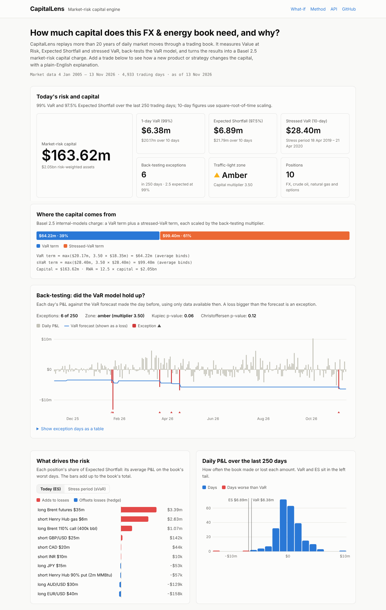

# CapitalLens

**How much market-risk capital does a trading book need, and why?** CapitalLens computes historical-simulation VaR, Expected Shortfall and stressed VaR for an FX and energy book, back-tests the VaR model, turns the results into a Basel 2.5 capital charge, and explains in plain English how a new trade would change it.

**Live demo:** https://capitallens-delta.vercel.app · **API docs:** https://capitallens-delta.vercel.app/api/docs



## Features

- **Real market data:** 4,933 daily snapshots (Jan 2005 to Nov 2026) of EUR, GBP, AUD, JPY, INR and CAD against the USD (US Federal Reserve H.10 via FRED), plus Brent crude and Henry Hub natural gas (US EIA), committed to the repo so the app needs no outside calls.
- **Sample trading book:** 8 delta-one FX and energy positions and 2 European options (a long Brent call, a short Henry Hub put).
- **Historical-simulation VaR:** today's book is revalued under every past day's moves. Options are fully repriced with Black's formula, so their convexity is captured. 99% VaR = the 3rd-worst of 250 days.
- **Expected Shortfall (97.5%):** the average of the worst 2.5% of days (6.25 days, with the 7th weighted by 0.25).
- **Stressed VaR:** VaR over the 250-day window in the history that hurts this book the most. For the sample book that is the April 2019 to April 2020 window, which ends in the 2020 oil crash.
- **Back-testing:** each of the last 250 days is compared with the VaR forecast made the day before, using only earlier data. Exceptions feed the Basel traffic light (green 0–4, amber 5–9, red 10+), the Kupiec proportion-of-failures test and the Christoffersen independence test.
- **Regulatory capital (Basel 2.5 internal models):** `max(VaR, m × 60-day avg VaR) + max(sVaR, m × 60-day avg sVaR)`, where m = 3 + the traffic-light plus factor. RWA = 12.5 × capital.
- **Risk drivers:** each position's contribution to ES (and to stressed VaR). The contributions add up exactly to the book's total.
- **What-if for new products and strategies:** add up to 5 trades (delta-one or options). The engine re-runs everything with the stress period held fixed and explains the change in plain English, for example: *"Adding short Brent crude put (90% strike, 0.25y) raises market-risk capital by $84.77m (51.8%) … Most of the change comes from the stressed-VaR term."*

## Architecture

```
data/market_data.csv ──► capitallens/data.py        load and validate prices (USD per unit)
data/book.json        ──► capitallens/instruments.py linear + Black option pricing, scenario P&L
                          capitallens/risk.py        VaR, ES, rolling VaR, stress window, contributions
                          capitallens/backtest.py    exceptions, traffic light, Kupiec, Christoffersen
                          capitallens/capital.py     Basel 2.5 IMA capital and RWA
                          capitallens/explain.py     plain-English commentary
                          capitallens/engine.py      analyse(book) and what_if(book, trades)
api/index.py  (FastAPI) ──► GET /api/summary · POST /api/what-if · GET /api/health · /api/docs
public/       (HTML + JS) ──► dashboard with SVG charts, served as static files
```

On Vercel, `public/` is served as static files and `api/index.py` runs as a Python function (`vercel.json` routes `/api/*` to it). The engine depends only on NumPy, and one full analysis takes about 15 ms.

## Stack

Python 3.12 · NumPy · FastAPI · Pydantic · vanilla JavaScript with hand-drawn SVG charts · pytest · Ruff · GitHub Actions · Vercel

## Run locally

```bash
git clone https://github.com/Shreyashsalv2/capitallens && cd capitallens
python3 -m venv .venv && source .venv/bin/activate
pip install -r requirements-dev.txt
python3 -m uvicorn scripts.dev_server:app --reload
# open http://127.0.0.1:8000
```

Use the engine directly:

```python
from capitallens.data import load_book, load_market_data
from capitallens.engine import analyse, what_if

md = load_market_data()
report = analyse(load_book(), md)
print(report["metrics"]["var_1d"], report["capital"]["total"])
print("\n".join(what_if(load_book(), [{"type": "linear", "factor": "BRENT", "notional": -35e6}], md)["explanation"]))
```

Refresh the market data: `python3 scripts/fetch_data.py`

## Tests

```bash
pytest -v        # 60 tests
ruff check .
```

The tests check VaR and ES against hand-calculated order statistics, the Basel traffic-light table, Kupiec and Christoffersen against their closed-form formulas, put-call parity and a known Black price, that contributions add up to the totals, that back-testing never uses future data, and the API's input validation. CI runs them on every push.

## Simplifications

Zero interest rates, constant implied volatility, spot prices used as a proxy for futures, a static book over the 60-day averaging window, and square-root-of-time 10-day scaling. Henry Hub spot prices have real one-day spikes (for example, +265% on 23 Jan 2026), so gas positions show much higher VaR than front-month futures would. This is an educational model and is not affiliated with any bank.

## License

MIT © 2026 Shreyash Singh Salv
